# Sommelle

[](https://github.com/Relthdrarxash/sommelle/actions/workflows/ci.yml)

Application Android d'accompagnement à l'insomnie fondée sur la TCC-I (thérapie cognitivo-comportementale de l'insomnie). Gratuite, en français, sans compte, et 100 % locale : aucune donnée ne quitte le téléphone.

Sommelle est un outil d'accompagnement et d'éducation. Ce n'est pas un dispositif médical et il ne remplace pas un avis médical.

## Aperçu

<table>
  <tr>
    <td align="center">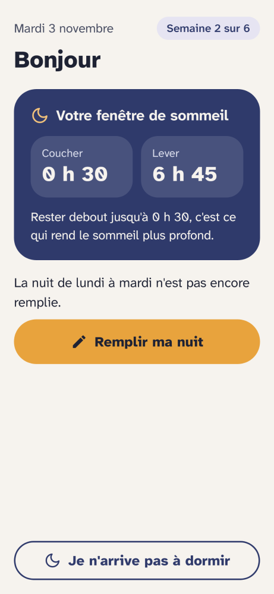<br>Accueil</td>
    <td align="center">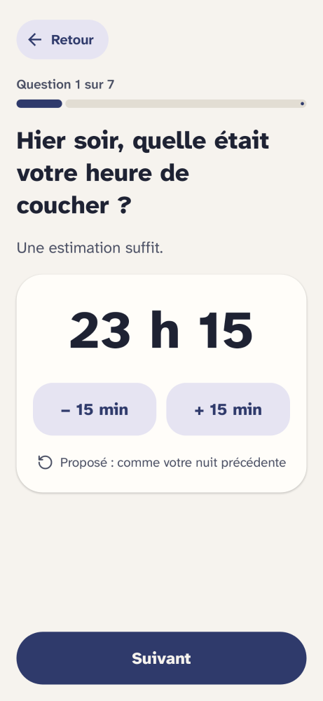<br>Agenda guidé</td>
    <td align="center">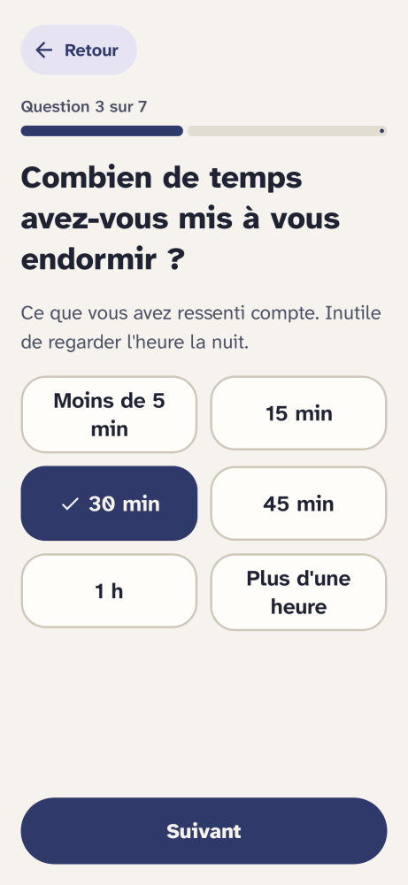<br>Estimations</td>
  </tr>
  <tr>
    <td align="center">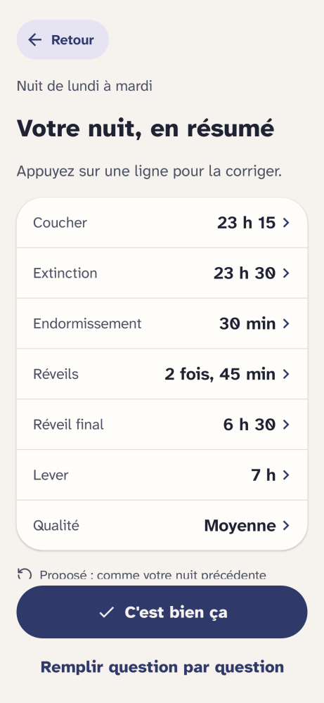<br>Agenda résumé</td>
    <td align="center">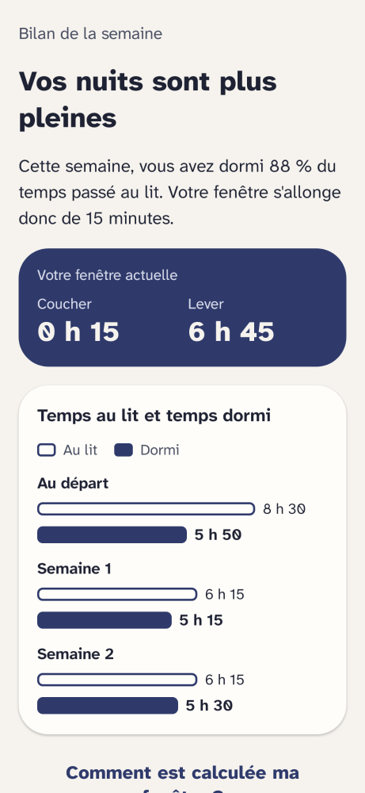<br>Bilan de la semaine</td>
    <td align="center">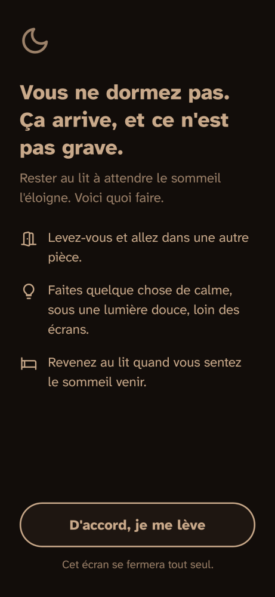<br>Je n'arrive pas à dormir</td>
  </tr>
  <tr>
    <td align="center">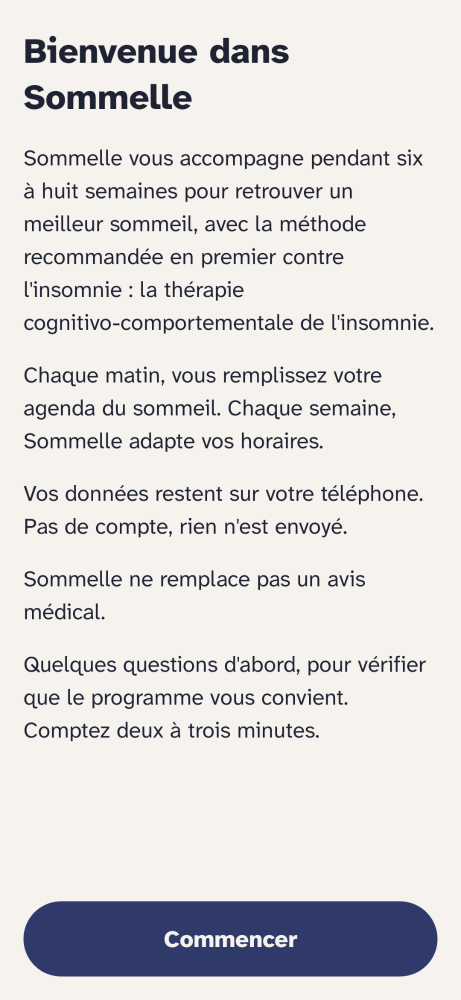<br>Bienvenue</td>
    <td align="center">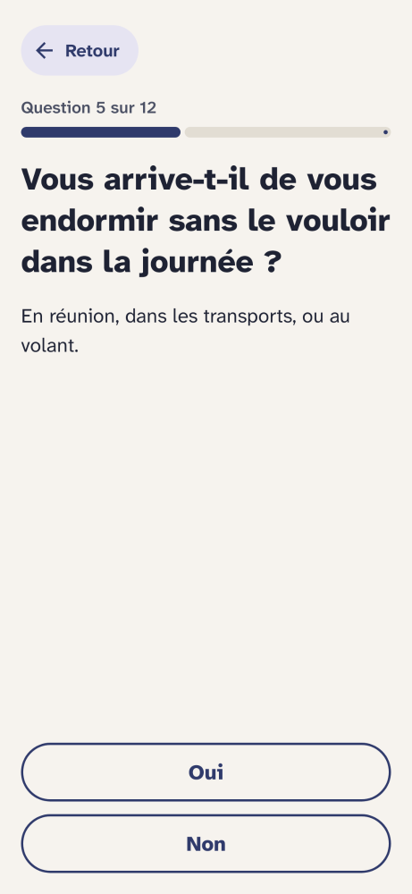<br>Questionnaire</td>
    <td align="center">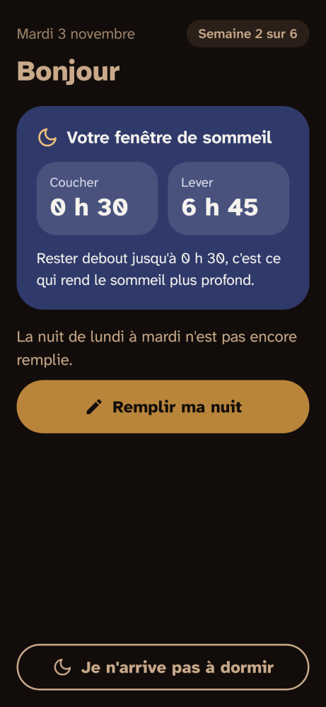<br>Thème de nuit</td>
  </tr>
  <tr>
    <td align="center">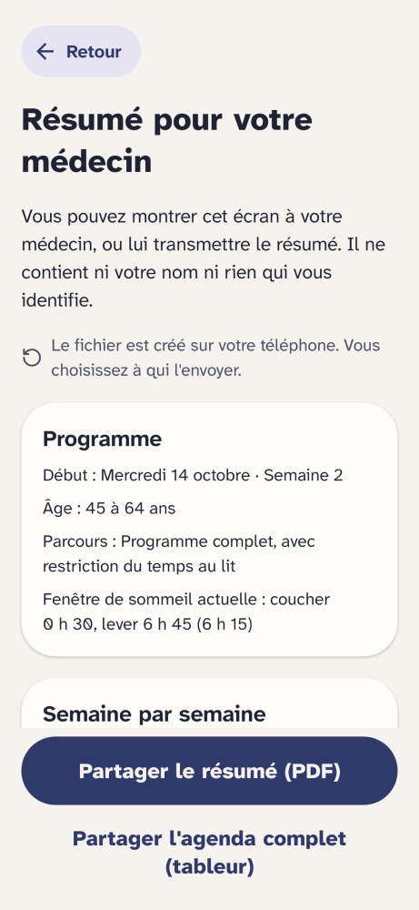<br>Résumé pour le médecin</td>
    <td align="center">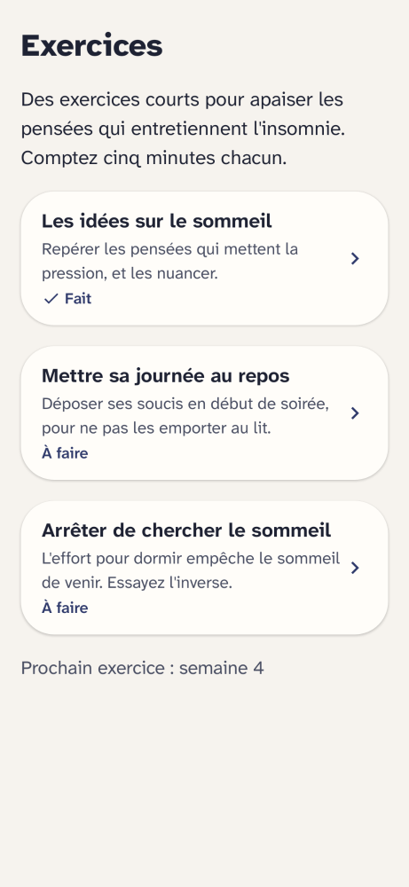<br>Exercices</td>
    <td align="center">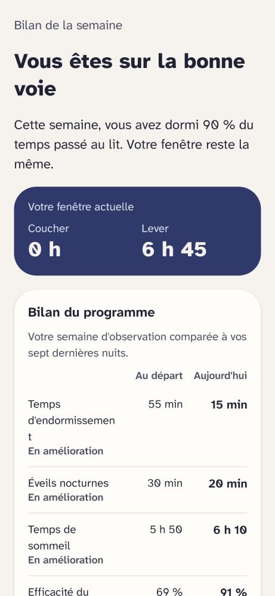<br>Bilan avant/après</td>
  </tr>
</table>

Ces captures sont générées automatiquement à partir du code des écrans à chaque modification (voir [CONTRIBUTING.md](CONTRIBUTING.md)) : elles sont toujours à jour.

## État

| Module | Contenu | État |
|---|---|---|
| `core:model` | Agenda du sommeil (Consensus Sleep Diary), questionnaire d'entrée, fenêtre de sommeil | Fait |
| `core:protocol` | Métriques, validation de l'agenda, questionnaire de sécurité, restriction du temps au lit, plan du programme | Fait, testé |
| `core:presentation` | Mise en forme française, brouillon d'agenda, déroulé du questionnaire, calendrier du programme, bilan hebdomadaire | Fait, testé |
| `core:data` | Base Room locale, dépôt unique, synchronisation des fenêtres | Fait |
| `core:designsystem` | Thèmes jour et nuit, police Atkinson Hyperlegible Next, composants accessibles | Fait |
| `feature:onboarding` | Accueil et questionnaire d'entrée | Fait |
| `feature:home` | Accueil quotidien, choix de l'heure de lever | Fait |
| `feature:diary` | Agenda guidé et résumé | Fait |
| `feature:week` | Bilan de la semaine et graphique | Fait |
| `feature:night` | Écran « Je n'arrive pas à dormir » | Fait |
| `feature:cognitive` | Cinq exercices cognitifs, débloqués à partir de la semaine 2 | Fait |
| `feature:export` | Résumé pour le médecin : à l'écran, en PDF et en tableur | Fait |
| `feature:reminders` | Rappels du matin et du soir (WorkManager, sans réseau) | Fait |
| `feature:settings` | Rappels, résumé, confidentialité, effacement des données | Fait |
| À venir | Intégrations Health Connect et signaux d'écran | À faire |

Les modules `core:model`, `core:protocol` et `core:presentation` sont en pur Kotlin, sans dépendance Android : les règles cliniques et la logique des écrans sont lisibles et testables isolément. Toutes les valeurs cliniques sont dans `ProtocolConfig`, avec un numéro de version.

## Compiler et tester

Ouvrir le projet dans Android Studio, ou en ligne de commande :

```bash
./gradlew test                 # tests des modules pur Kotlin
./gradlew :app:assembleDebug   # application de développement
```

## Documentation

- [DESIGN.md](DESIGN.md) : principes d'interface, pensés pour tous les publics et pour des personnes fatiguées.
- [Site de Sommelle](https://relthdrarxash.github.io/sommelle/), avec la page pour les professionnels de santé et la politique de confidentialité (sources dans `site/`).
- [docs/LANCEMENT.md](docs/LANCEMENT.md) : kit de lancement (messages, plan, stores, modèles de mails).
- [CONTRIBUTING.md](CONTRIBUTING.md) : intégration continue et publication.
- [ARCHITECTURE.md](ARCHITECTURE.md) : socle scientifique et sources, règles de sécurité, typologie des utilisateurs, parcours, architecture, accessibilité, périmètre du MVP et points à faire valider par un professionnel du sommeil.

## En cas de détresse

Si vous traversez une période difficile, le 3114 (numéro national de prévention du suicide) est joignable gratuitement, 24 h/24 et 7 j/7.

## Licence

Sommelle est distribuée sous licence [GNU GPL v3.0](LICENSE). Vous pouvez l'utiliser, l'étudier, la modifier et la redistribuer, à condition que toute version redistribuée reste publiée sous la même licence, avec son code source.
